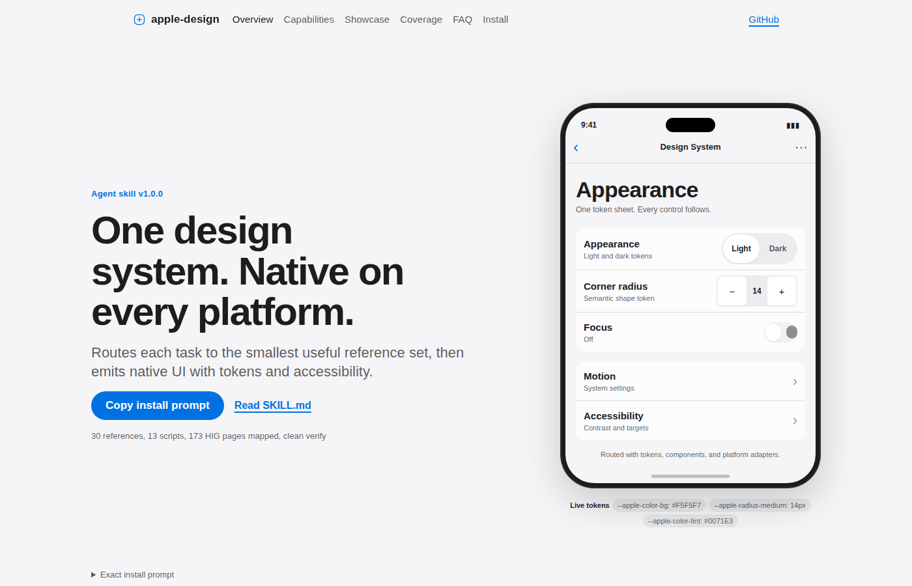
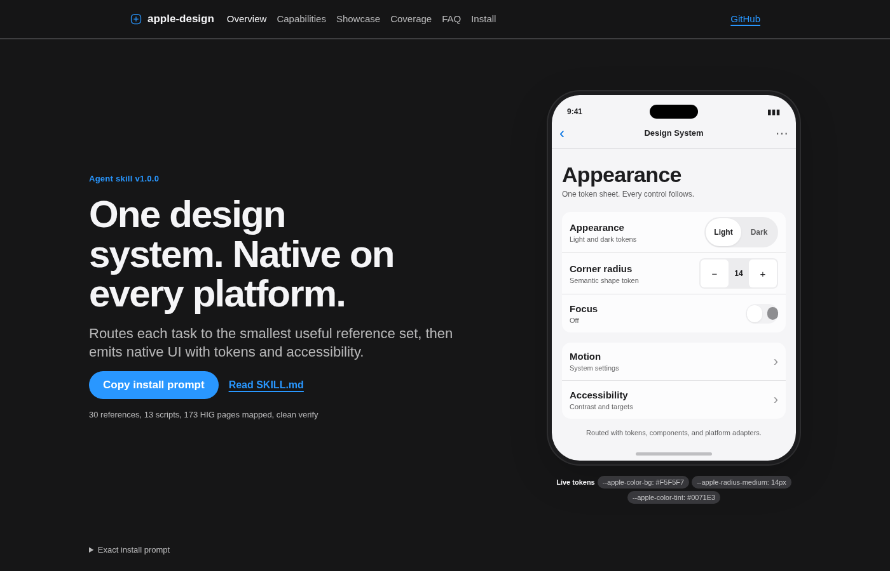
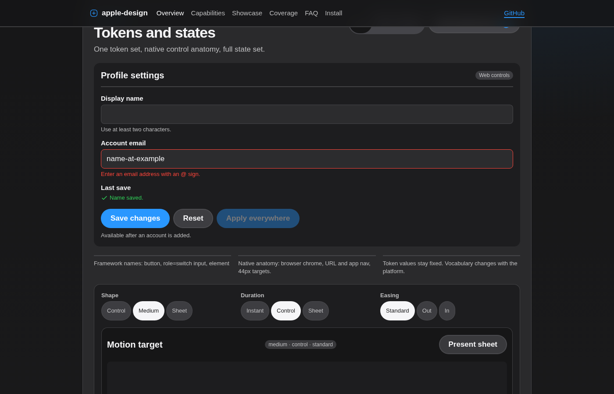
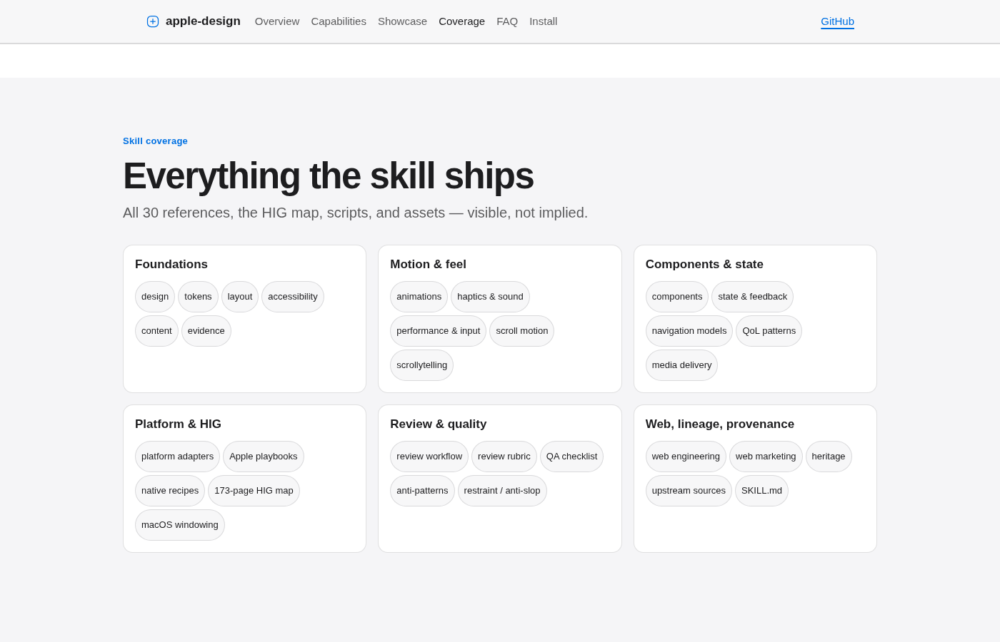
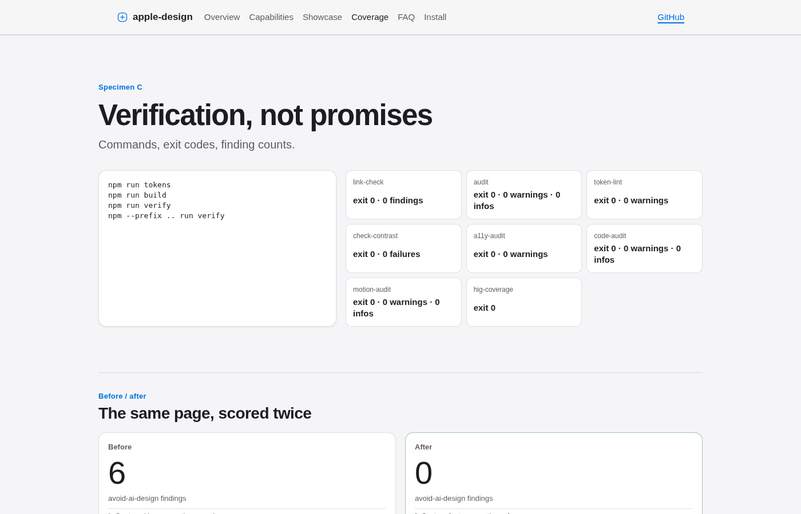
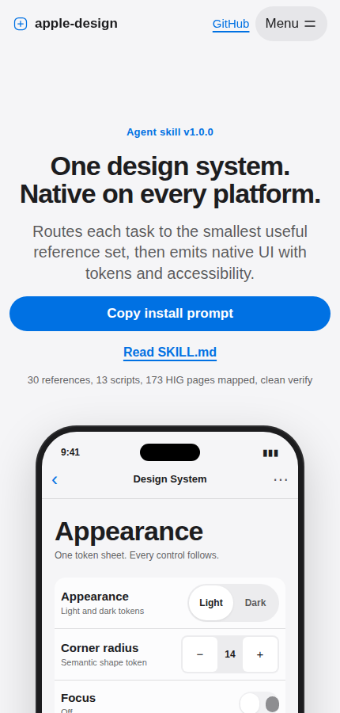

# apple-design

**Apple-inspired, animation-driven, platform-native UI skill for agents.** Progressive disclosure, 30 reference docs, 13 scripts, 173 Apple HIG pages mapped to owning rules, a flagship demo, and a working showcase.

<p>
  <a href="#install">Install</a> ·
  <a href="#showcase">Showcase</a> ·
  <a href="#flagship-web-demo">Demo</a> ·
  <a href="#verification">Verification</a> ·
  <a href="#structure">Structure</a>
</p>

> Apple-inspired, not Apple-branded or affiliated. The skill maps public HIG topics into paraphrased, auditable rules — it does not copy Apple content.



## At a glance

| | |
|---|---|
| **Skill** | `apple-design` v1.0.0 · snapshot 2026-11-21 |
| **Coverage** | 30 reference docs · 13 script files · 2 JSON maps · 15 example files |
| **HIG** | 173 public HIG pages mapped to owning skill refs (`hig-coverage-check --strict`) |
| **Motion** | Animation-driven posture: springs, velocity, interruptibility, haptics, Reduce Motion |
| **Proof** | `demo/` flagship page + `showcase/` Vite showcase with recorded verification |
| **Verification** | `npm run verify` clean (links, audits, tokens, contrast, a11y, code, motion, HIG coverage) |

## Showcase

The [`showcase/`](showcase/) is a working front door for the skill. It demonstrates the skill’s own rules: semantic tokens, real states, HIG-aware routing, animation-driven behavior, and verifiable output.

<table>
  <tr>
    <td width="50%"><br /><sub>Dark appearance, semantic Apple-aligned palette.</sub></td>
    <td width="50%"><br /><sub>Working specimens: tokens/states, HIG router, verification.</sub></td>
  </tr>
  <tr>
    <td width="50%"><br /><sub>All 30 references surfaced in the Skill Coverage section.</sub></td>
    <td width="50%"><br /><sub>Real command results: motion audit + 173-page HIG coverage.</sub></td>
  </tr>
</table>

<details>
<summary>Mobile screenshot</summary>



</details>

Run it locally:

```bash
npm --prefix showcase install
npm --prefix showcase run dev
```

Build / verify:

```bash
npm --prefix showcase run build
npm --prefix showcase run verify
npm --prefix showcase run verify:record
```

## Install

Copy-paste this into your agent:

```text
Install the apple-design skill for me from https://github.com/KenshienAlao/apple-design-skill.git
Read SKILL.md first, then load only the references my task needs. Do not load
the whole corpus unless I ask for a full build or full audit.
```

Manual install: copy the complete skill folder (`SKILL.md`, `references/`, `examples/`, `assets/`, `scripts/`, `demo/`, `showcase/`, `README.md`, `LICENSE`, `THIRD_PARTY.md`) into your agent’s skills directory. When upgrading, replace the old folder.

## Use

```text
Use apple-design to build a settings screen with Apple-style tokens for Android.
Use apple-design to audit this page against the five-lens review workflow.
Use apple-design in flagship web mode for this landing page.
Use apple-design to map this feature to the Apple HIG and apply the right patterns.
Use apple-design to generate CSS, Swift, Compose, and Android XML tokens.
```

The agent loads the minimum reference set and names applied references + assumptions.

| Lane | Start with |
|---|---|
| Native/product UI | `design`, `animations`, `tokens`, `components`, `state-and-feedback`, `accessibility`, `content` |
| Apple platform / HIG | `apple-hig-mapping`, `apple-platform-playbooks`, `apple-native-recipes`, `apple-component-fidelity-map.json` |
| Motion / feel | `animations`, `scroll-motion`, `scrollytelling`, `haptics-and-sound`, `perceived-performance-and-input` |
| Flagship web | `restraint-and-antislop`, `web-marketing-language`, `web-engineering`, `media-assets-and-delivery`, `scroll-motion` |
| Audit / review | `review-workflow`, `qa-apple-style`, `apple-review-rubric`, `anti-patterns`, `evidence-apple-style` |

## What makes it 1.0.0

- **173-page HIG adoption**. Full public HIG topic map in [`references/apple-hig-mapping-apple-style.md`](references/apple-hig-mapping-apple-style.md), with owning refs and strict coverage check.
- **Animation-driven**. Motion is product behavior: posture, springs, velocity, interruptibility, haptics, and Reduce Motion parity. Enforced by [`scripts/motion-audit.mjs`](scripts/motion-audit.mjs) and QA.
- **Platform-native, Apple-inspired**. Apple is the craft lens; host platform idioms win. No Apple branding/assets copying.
- **Verification in the box**. Links, audit, token lint, contrast, a11y, code hygiene, motion audit, HIG coverage, token generation, motion probe.

## Flagship web demo

The [Lumen demo](demo/index.html) is a complete static page built with the skill. It uses semantic tokens, generated SVG media, native controls, real states, damped scroll-progress, dark chapter, keyboard path, and Reduce Motion/no-script end states.

```bash
node scripts/a11y-audit.mjs demo --strict --platform=web
node scripts/code-audit.mjs demo --strict
node scripts/audit.mjs demo --strict --platform=web
node scripts/token-lint.mjs demo --strict
```

## Verification

```bash
npm run verify
```

`npm run verify` runs:

```bash
node scripts/link-check.mjs . --strict
node scripts/audit.mjs . --strict
node scripts/token-lint.mjs . --strict
node scripts/a11y-audit.mjs . --strict
node scripts/code-audit.mjs . --strict
node scripts/motion-audit.mjs . --strict
node scripts/hig-coverage-check.mjs --strict
node scripts/check-contrast.mjs --strict
node scripts/generate-tokens.mjs --format=all --out=/tmp/opencode/design-tokens
node scripts/motion-probe.mjs --all
```

Optional rendered checks:

```bash
npm i -D playwright @axe-core/playwright pixelmatch pngjs
npx playwright install chromium
node scripts/a11y-probe.mjs --url=http://localhost:3000 --strict
node scripts/visual-diff.mjs --url=http://localhost:3000 --routes=/,/settings --baseline=./visual-baseline --out=./visual-diff
```

## Structure

```text
apple-design/
├── SKILL.md
├── README.md
├── LICENSE
├── THIRD_PARTY.md
├── package.json
├── references/                  # 30 reference docs
├── examples/                    # good/bad + reference implementations
├── demo/                        # flagship static demo (Lumen)
├── showcase/                    # Vite showcase for the skill
├── docs/
│   └── screenshots/             # README/showcase screenshots
├── assets/
│   ├── apple-component-fidelity-map.json
│   └── sf-symbols-map.json
├── scripts/
│   ├── a11y-audit.mjs
│   ├── a11y-probe.mjs
│   ├── audit.mjs
│   ├── check-contrast.mjs
│   ├── code-audit.mjs
│   ├── generate-tokens.mjs
│   ├── hig-coverage-check.mjs
│   ├── link-check.mjs
│   ├── motion-audit.mjs
│   ├── motion-probe.mjs
│   ├── token-lint.mjs
│   └── visual-diff.mjs
└── _vendor/                     # optional research snapshot, skipped by scripts
```

## Attribution

Distilled from [Apple Human Interface Guidelines](https://developer.apple.com/design/human-interface-guidelines), [s1gmamale1/apple-design-skills](https://github.com/s1gmamale1/apple-design-skills), [dickwu/apple-design-skill](https://github.com/dickwu/apple-design-skill), and [justinwetch/HIGAgentSkills](https://github.com/justinwetch/HIGAgentSkills). The [scored rubric](references/apple-review-rubric-apple-style.md) is informed by independent craft-review practice.

Independent project, not affiliated with or endorsed by Apple Inc. No Apple-owned media, logos, screenshots, video, bezels, or captured frames are bundled.

## License

MIT for code and original material. See [LICENSE](LICENSE) and [THIRD_PARTY.md](THIRD_PARTY.md).
